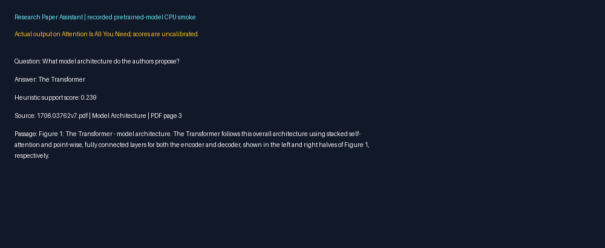
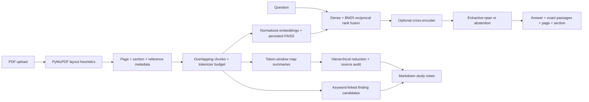

# Research Paper Assistant

Upload research PDFs, find cited passages, ask extractive questions, generate
hierarchical summaries, inspect structured finding candidates, and download study
notes. Python, PyMuPDF, Sentence Transformers, FAISS, BM25, Transformers, FastAPI
and Gradio. Designed for an 8 GB CPU laptop, with optional GPU evaluation.

**Status:** the application, real-model smoke workflow and CPU benchmarks have been
executed. Quality is limited: baseline QASPER token F1 is 0.103. This is a portfolio
study tool whose outputs require source verification. Manual reviews and i3 laptop
measurements remain pending. See [measured results](data/eval/results/RESULTS.md).





## Install locally (Linux/macOS terminal, Python 3.10–3.12)

Python 3.12 was used for current validation. Windows users can use WSL2. Clone the
existing repository; no new repository needs to be created.

```bash
git clone https://github.com/GaurikMehrotra/-Research-Paper-Assistant.git
cd -- -Research-Paper-Assistant
bash scripts/setup.sh
source .venv/bin/activate
export HF_HOME="$PWD/.cache/huggingface"
export MPLCONFIGDIR="$PWD/.cache/matplotlib"
export XDG_CACHE_HOME="$PWD/.cache"
export GRADIO_ANALYTICS_ENABLED=False
make lint test
```

CPU PyTorch is installed first from the official CPU wheel index. Other versions
are pinned in `requirements.txt`. `requirements-lock-py312-linux.txt` records the
tested Linux/Python 3.12 resolution; it is not a cross-platform lock. For the same
platform, reproduce it after installing CPU PyTorch with:

```bash
python -m pip install -r requirements-lock-py312-linux.txt --extra-index-url https://download.pytorch.org/whl/cpu
python -m pip check
```

The first model operation downloads weights from Hugging Face. Enable HTTPS access
to `huggingface.co`, `*.huggingface.co`, `*.hf.co`; sample downloads need `arxiv.org`
and `export.arxiv.org`. No API keys are needed for the public models. Do not disable
TLS verification to work around access errors. Cache folders and all PDFs are ignored.

## Use the application

```bash
python -m scripts.download_papers 1706.03762v7 1810.04805v2
make ui
```

Open the local Gradio address printed by the command on your laptop. Upload a PDF,
select it, ask a question, and inspect the highlighted literal answer inside its
source passage. Summary output includes every map summary's citation. Findings are
candidate evidence sentences. Study notes download as Markdown. No public share
link is created. Treat a first upload as a model download + indexing operation.

Run the backend separately when developing API integrations:

```bash
make api
curl -fsS http://127.0.0.1:8000/health
curl -fsS -F 'file=@data/papers/1706.03762v7.pdf' http://127.0.0.1:8000/papers
curl -fsS http://127.0.0.1:8000/papers
curl -fsS -H 'Content-Type: application/json' -d '{"question":"What architecture is proposed?"}' http://127.0.0.1:8000/ask
```

Use the returned `paper_id` in `/papers/{paper_id}/summary`, `/findings`, and `/notes`.
API docs are exposed locally by FastAPI. These loopback addresses are local laptop
instructions; cloud onboarding does not provide web preview links.

CLI workflow:

```bash
python -m src.pipeline --config configs/fast_cpu.yaml ingest data/papers/1706.03762v7.pdf
python -m src.pipeline --config configs/fast_cpu.yaml papers
python -m src.pipeline --config configs/fast_cpu.yaml search 'What architecture is proposed?'
python -m src.pipeline --config configs/fast_cpu.yaml ask 'What architecture is proposed?'
```

For `summary`, `findings` and `notes`, supply a returned paper ID as the last argument.
`--paper-id` restricts `search` and `ask` to one paper; omission searches all cached
papers for this configuration. Different parsing/chunking/embedding settings use
different cache namespaces. A repeated upload does not re-embed its document. Summary
cache keys include the model and summary settings. Artifacts are JSON + FAISS, not
pickle. Never load an untrusted FAISS artifact.

## CPU budget and correctness

Start with `configs/fast_cpu.yaml`: MiniLM embeddings, FLAN-T5-small, batch size 1,
two Torch threads, no reranking, and a tiny evaluation subset. `default.yaml` uses BGE,
FLAN-T5-base, and reranking. Models are unloaded after each operation and operations
are serialized within a process. Run **one application and one worker** on the laptop;
running API and UI together can load multiple models in separate processes. Index
vectors and evidence remain in memory, so unlimited corpora do not have a fixed RAM
bound. Measure your workload; under 5 GB is a target, not a verified guarantee.

Chunks never cross a page or section. Word overlap preserves nearby context;
tokenizer-offset splitting additionally ensures embedding inputs fit the configured
context and preserves literal source text. Page/section boundaries can split an
answer; this is an explicit tradeoff for precise citations. References remain in
processed passage records, excluded from all QA indexes, and can be looked up there.

Summarization maps **every** non-reference chunk. Overlong source text is partitioned
into overlapping token windows rather than truncated; map outputs are recursively
reduced in token-budgeted windows. A non-converging reduction fails explicitly instead
of dropping remaining text. Overlap can duplicate facts, and map-reduce can lose
qualifiers or invent claims. Source audit entries are provenance, not entailment proof.

QA answers must be literal source spans, exceed both configured cosine and span-score
thresholds, and include source passage, paper name, section and one-based PDF page.
Otherwise the assistant says `not found in the paper`. False answers and false
abstentions are still possible. The support score is an uncalibrated heuristic, not
a probability or scientific confidence interval. Multi-hop reasoning and yes/no
questions are poor fits for this extractive model and remain in QASPER evaluation.

## Evaluation and results

```bash
python -m scripts.prepare_eval --questions 30 --summaries 2 --output data/eval/corpus.json
python -m src.eval.run --config configs/evaluation_cpu.yaml --corpus data/eval/corpus.json --output data/eval/runs/baseline
python -m scripts.ablations --config configs/evaluation_cpu.yaml --corpus data/eval/corpus.json --compare-summaries
python -m scripts.report data/eval/runs/ablations
python -m scripts.model_manifest --output data/eval/model_versions.json
```

The preparation helper reads official Parquet shards in small batches. Selection
is deterministic and source ordered: 30 QASPER questions (29 with retrieval evidence)
and two arXiv articles. These small samples do not support general accuracy claims.
Model commit revisions are pinned in YAML and recorded in `data/eval/model_versions.json`.

| CPU experiment | Recall@5 | MRR | QA F1 |
| --- | ---: | ---: | ---: |
| MiniLM hybrid baseline | 0.300 | 0.357 | 0.103 |
| Dense only | 0.281 | 0.271 | 0.104 |
| Hybrid + reranker | 0.317 | 0.332 | 0.088 |
| BGE hybrid, same token budget | 0.435 | 0.462 | 0.158 |

On two arXiv articles, ROUGE-L / raw DistilBERT BERTScore F1 were 0.014 / 0.642
for FLAN-T5-small, 0.079 / 0.682 for FLAN-T5-base, and 0.138 / 0.774 for
DistilBART. Similarity scores do not establish factual correctness. The small model
produced irrelevant and repetitive summaries in these examples.

Measured peak process RSS was approximately 0.95 GB for the baseline, 1.60 GB for
FLAN-T5-base and 1.93 GB for DistilBART. Measurements used a cloud CPU with five
logical CPUs, two Torch threads and 33 GB RAM, **not the requested i3 laptop**.
Query latency includes model loading; see the full ablation table and saved configs.
Reranking increased retrieval latency and lowered QA F1 on this subset. These are
observations, not statistically established improvements.

Completed runs save config YAML, raw predictions, summaries, metric JSON, manual-review
CSV, latency and sampled peak RSS. The report command produces a CSV/Markdown table
and a PNG. Ablations change one factor at a time and keep seed/corpus/subset constant.
Recall@k is macro recall of labelled relevant chunks; MRR is truncated to the returned
top-k list. Embedding/chunk changes alter relevance units, so also inspect paragraph
coverage before interpreting comparisons. Dataset benchmarks use source paragraph
positions explicitly labelled as such; **QASPER has no PDF page labels** and does not
validate parsing. BERTScore/ROUGE measure reference similarity, not factual truth.

Fill the 30 rows in `data/eval/custom_questions.csv` after inspecting the sample PDFs.
Use actual paper IDs, exact extracted evidence, section, and PDF page. Store reference
answers as a JSON array of strings, or `unanswerable=true` for absence questions.

```bash
python -m scripts.custom_corpus --config configs/fast_cpu.yaml
python -m src.eval.run --config configs/evaluation_cpu.yaml --corpus data/eval/custom_corpus.json --output data/eval/runs/custom
python -m scripts.check_review data/eval/runs/custom/manual_review.csv --minimum 20
```

The evaluation config includes all 30 custom questions. Review at least 20 real answers
against their full sources, fill `faithful` and `citation_correct` with `yes`, `no`
or `unclear` where allowed, and categorize errors. The supplied blank review template
is not completed evaluation. A notebook supports inspection, not metric generation.
Do not publish quality claims before these measurements and reviews exist.

## Learning phases and optional GPU

[The 14-phase terminal guide](docs/PHASES.md) explains why each component exists,
the commands, expected outputs, code locations and suggested commit commands. Full
file implementations are in this repository. All phases can run locally; optional
Kaggle cells for sequential batch evaluation are in [docs/KAGGLE.md](docs/KAGGLE.md).

## Limitations and responsible use

- Layout handling is heuristic: standard two-column blocks, repeated margins,
  common headings, and wrapped hyphenation. Complex figures/tables, mathematical
  notation, unusual reading order, multi-line headings and mixed scans need review.
- English pretrained models may fail on specialized terminology, non-English papers,
  long questions, numerical comparison, negation, tables, and out-of-domain questions.
- Small summaries can omit evidence or hallucinate. Extractive spans can answer the
  wrong question. Keyword findings are source candidates, not validated structured facts.
- The local API/UI have no authentication and are not production deployments. Upload
  only material you may process; do not expose these services to the public Internet.
- Download only legally accessible papers, respect licenses and arXiv rate limits,
  and never commit PDFs. Open access does not grant unrestricted redistribution.
- The source MIT license does not override upstream model/dataset/paper licenses.

See [MODEL_CARD.md](MODEL_CARD.md), [error analysis](docs/ERROR_ANALYSIS.md), and the
[final checklist](docs/CHECKLIST.md). The automated benchmarks and real-model demo are recorded; manual faithfulness review,
user-written labels, target-laptop measurements and remote CI observation remain separate.
